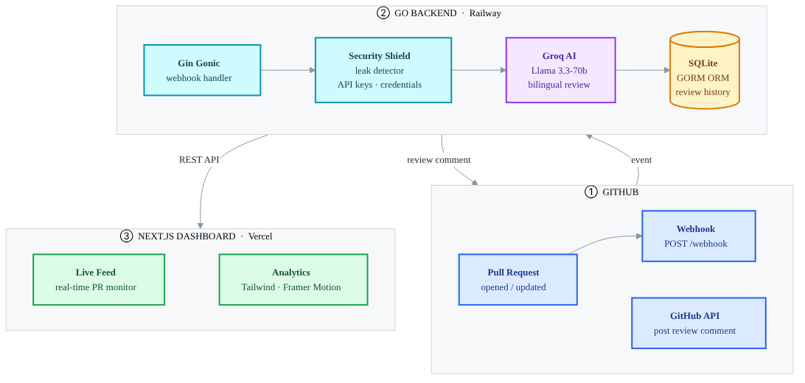

<div align="center">

# ⚡ DevPulse: AI-Powered Code Reviewer

### Automated GitHub PR Review · Bilingual Analysis · Security Shield

Real-time code review on every Pull Request. Groq AI (Llama 3.3) writes
the feedback, Go delivers it in under 2 seconds, Next.js shows the history.

<br/>


</div>

---

## 🔗 Live Demo

- **Dashboard:** [https://devpulse-ai-iota.vercel.app/](https://devpulse-ai-iota.vercel.app/)
- **Backend API:** [https://devpulse-ai-production.up.railway.app/](https://devpulse-ai-production.up.railway.app/)

---

## 📐 Architecture



The system follows a modern event-driven architecture:

`GitHub Webhook` ➡️ `Go Backend (Railway)` ➡️ `Groq AI` ➡️ `GitHub API (Comment)` ➡️ `Next.js Dashboard (Vercel)`

---

## 🚀 Key Features

| Feature | Description |
|:---|:---|
| **🌍 Bilingual Analysis** | English technical summary for global teams with deep Indonesian insights |
| **🛡️ Security Shield** | Automatically detects leaked API keys, database credentials, and plaintext passwords |
| **💡 Commit Suggestions** | Direct code fixes that can be applied with one click via GitHub |
| **📊 Professional Dashboard** | Real-time monitoring feed built with Next.js, Tailwind CSS, and Framer Motion |

---

## 🛠️ Tech Stack

| Layer | Technology | Role |
|:---|:---|:---|
| **Backend** | Go (Golang) · Gin Gonic · GORM | High-performance webhook handler, event processing |
| **AI Engine** | Groq API · Llama 3.3-70b-versatile | Bilingual code review generation |
| **Database** | SQLite | Review history, PR metadata |
| **Frontend** | Next.js 14 · TypeScript · Tailwind CSS | Real-time monitoring dashboard |
| **UI** | Framer Motion · Lucide React | Smooth animations, icon system |
| **Workflow** | GitHub Apps · Webhooks | PR event subscription, comment posting |
| **Deployment** | Railway (backend) · Vercel (frontend) | Zero-downtime production hosting |

---

## 🚀 Quick Start

```bash
# 1 — Backend
git clone https://github.com/immanueltampubolon594/devpulse-ai.git
cd devpulse-ai
cp .env.example .env    # fill in GROQ_API_KEY and GITHUB_APP credentials
go mod download
go run main.go

# 2 — Frontend
cd frontend
npm install
npm run dev             # http://localhost:3000
```

---

## 👤 Author

**Immanuel Tampubolon** — [GitHub](https://github.com/immanueltampubolon594) · [LinkedIn](https://linkedin.com/in/immanuel-tampubolon-4a950840b)
